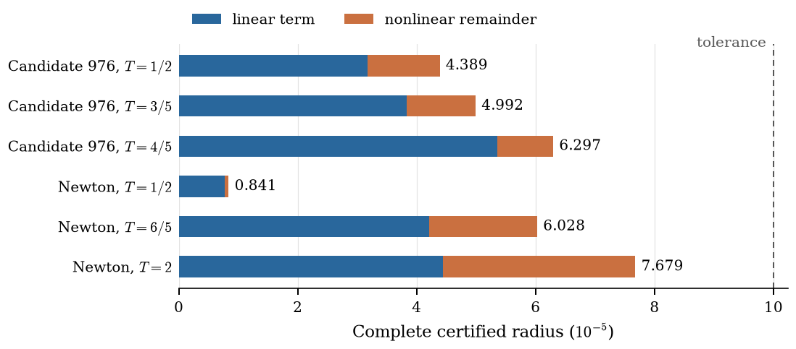

# Certified cylinder drag: verification companion

**Version 1.0.0**, prepared 26 November 2026 for repository tag `paper1-v1.0.0`.

Companion code and documentation for Erik Burman and Mats G. Larson,
*Certified drag for a three-dimensional Navier–Stokes wake and the horizon of energy-based certification*.

The completed certificate at **T = 2** encloses the specified drag functional in

```
[0.112699029269657744, 0.112852594864699145]
```

The complete radius is less than **7.678280 × 10⁻⁵**, including the nonlinear
remainder and evaluation allowances. The claim applies to every member of the
paper's specified energy-inequality weak-solution class, with the exact archived
initial field and stated model and arithmetic assumptions. It does not assume or
establish uniqueness of weak solutions. See [the scope](docs/SCOPE.md).



The six rows are separate certified reference/window pairs. The bars show the
linear and nonlinear terms; the printed bounds include the smaller evaluation
allowances. They do not establish every intervening time window.

## What is here, and what is in the data deposit?

This small repository contains a verification entry point, the exact certificate
records used by two manuscript figures, their source code and diagnostic inputs,
provenance, and instructions. It contains no large computational archives.

The version-specific evidence DOI is **10.5281/zenodo.24553449**. It was
reserved when this snapshot was prepared and becomes registered on publication.
The record URL is https://zenodo.org/records/24553449; check that record for
public availability. Its frozen archives are:

| File | Purpose | Bytes |
|---|---|---:|
| `T2_certificate_v1.tar.gz` | Completed T = 2 evidence, executed source snapshots, original verification programs | 3,575,472,381 |
| `earlier_certificates_2026-11-17.tar.gz` | Earlier certificates and their evidence | 1,559,932,836 |

The deposit also contains the standalone guide, manifests and reports. The exact
nine original submission files are pinned in [archive-lock.json](data/archive-lock.json).
The deposit includes `navier-stokes-certification-paper1-v1.0.0.zip`, a complete
repository source snapshot, and `SOFTWARE_RELEASE.json`, which binds its
SHA-256 hash to an exact Git commit and tag. The verification entry point can
therefore be obtained without relying on a live GitHub branch.

## Verify a local copy

Use Python 3.11 or later. The tested portable environment is Python 3.12.0,
NumPy 2.5.2 and mpmath 1.3.0 on macOS arm64. From `papers/paper1-certified-drag` within the source snapshot:

```sh
python3 -m venv .venv
. .venv/bin/activate
python -m pip install -r requirements-replay.txt
python -B tools/verify_bundle.py --source-dir /path/to/deposit-files --work-dir /path/to/new-verification
```

The source directory must contain the nine original submission files. Keep any
additional publication files alongside them. The work directory must not already
exist and must be outside the source directory. Allow at least 20 GB of free
space: the wrapper retains copies of the downloads, fresh extractions and reports.

The command checks all pinned file sizes and SHA-256 hashes before extraction,
then runs **seven checks using the original archived programs**. It stops on the
first failure. Reports and logs are written outside the extracted evidence, under
`new-verification/reports/`; `verification-summary.json` records the outcome,
environment, scope, inputs and individual report hashes. Existing directories are
refused to prevent accidental reuse of stale reports.

For the four standard-library checks alone, add `--mode records`; NumPy/mpmath
installation is then unnecessary. This reduced mode does **not** run the three
scalar/time, geometry and physical-cover replays. Neither mode reruns all
production spatial interval computations. Do not use Python `-O` or set
`PYTHONOPTIMIZE`.

After the deposit is public, the same command accepts `--base-url` instead of
`--source-dir` to download the nine pinned files from the record's HTTPS `/files`
directory. For this record, use `https://zenodo.org/records/24553449/files`
**after publication**. A fresh public-download replay remains a post-publication
check; it is not established by a successful local verification.

## Figures and lightweight checks

```sh
python -m pip install -r requirements-figures.txt
python -B -m unittest discover -s tests -v
python -B figures/make_certificate_figures.py
```

The figure script is preserved verbatim from the revised manuscript. It reads
the six JSON files in `evidence/` and the historical diagnostic table in
`figures/data/`; outputs are written under `figures/`. The existing PNG previews
are copied from the manuscript. The horizon plot explicitly distinguishes
certified points from diagnostic forecasts. These packaging tests do not replace
the full evidence replay.

Read [verification details](docs/VERIFICATION.md), [data provenance](data/PROVENANCE.json),
[the preparation check results](docs/PREPARATION_CHECKS.md),
[release notes](docs/RELEASE_NOTES.md), and [licensing status](LICENSING.md).

## Citation and authorship

The authors are Erik Burman (University College London) and Mats G. Larson
(Umeå University). [CITATION.cff](CITATION.cff) identifies software version 1.0.0 and separately
references the version-specific evidence DOI. The dataset DOI is not a separate
software DOI. Cite the paper, this fixed software version and the evidence
record once published. No journal acceptance, public release date or author
ORCID is implied. Original software is MIT licensed; original data, figures
and documentation are CC BY 4.0 licensed, as scoped in [LICENSING.md](LICENSING.md).
